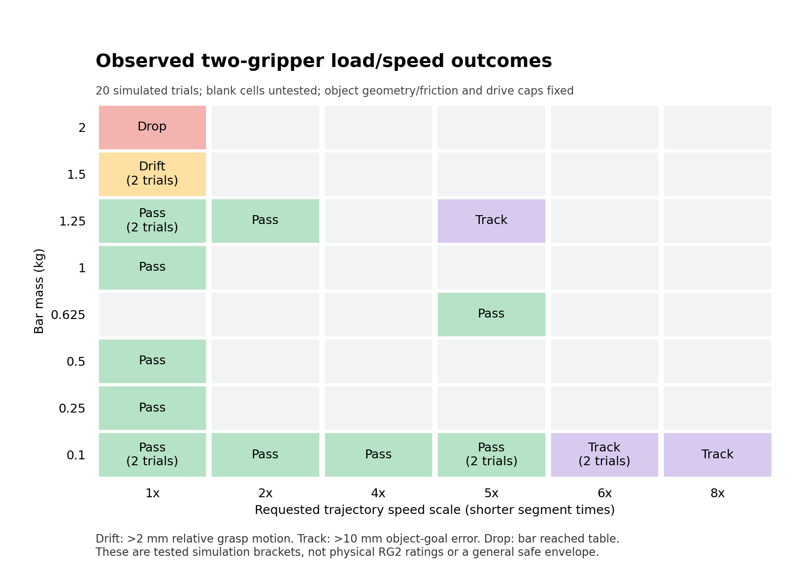

# Measured shared-bar load and speed limits

Tested on 2026-10-27 (America/Phoenix), Isaac Sim 5.1.0. This experiment keeps
the accepted two-gripper grasp, bar geometry, object material, and controller
settings fixed while varying mass/inertia and requested movement duration.
These are simulated, criterion-dependent brackets, not physical RG2 ratings.

## Main findings

| Experiment | Repeated pass | Repeated failure | Observed failure |
| --- | --- | --- | --- |
| Mass at baseline speed | 1.25 kg | 1.5 kg | 4.869 mm relative grasp drift exceeded the 2 mm threshold during initial load settling |
| Speed with 0.1 kg bar | 5x | 6x | 10.052 mm object-goal tracking error exceeded 10 mm; grip drift was only 0.252 mm |

The transition is bracketed **between** the tested endpoints, not proven equal
to either endpoint. Both endpoints of each bracket were repeated once and
agreed. At 2 kg the bar reached the ground-plane collider at 0.25 simulation
seconds during initialization; motion never began.

Combined conditions demonstrate that the one-variable limits cannot simply be
multiplied:

| Mass / speed | Result | Max relative drift | Max tracking error |
| --- | --- | --- | --- |
| 1.25 kg / 2x | Passed | 1.051 mm | 4.970 mm |
| 0.625 kg / 5x | Passed | 0.494 mm | 9.723 mm |
| 1.25 kg / 5x | Failed tracking | 0.459 mm before stopping | 10.080 mm |

In total: **20 trials, 13 passes and 7 failures**. Duplicate passing conditions
share browser names. Eleven short-named saved stages were separately replayed
and passed four-finger contact, clearance, relative-drift, gravity, kinematic,
and actual-mass checks. No failed condition is offered as an approved stage.

Blank cells are untested; the map does not interpolate a safe region.

## Protocol and fixed settings

- Start every trial from immutable shared-grasp checkpoint 06, using a unique
  setup layer so dirty cached stages cannot contaminate resets.
- Bar size 650x35x60 mm. Mass changed together with its cuboid inertia, using
  Ixx=m(y²+z²)/12 and corresponding Y/Z terms. The object remains dynamic with
  gravity. No object weld, kinematic movement, hidden support or pose command.
- Object material: static friction 0.8, dynamic friction 0.6, restitution 0.
  Finger materials are unchanged. These are simulation parameters, not measured
  friction coefficients for the lab interface.
- Both RG2 actuated drives retain maxForce=1.0, stiffness=10000, damping=1000,
  type `acceleration`; arm gains and disabled robot-chain gravity are unchanged.
  Physics scene is 120 Hz. See `fixed-settings.json` for measured settings.
- The path is translation `(0,+0.05,+0.03)` m, +10 degree yaw, +5 degree pitch,
  then return to the original held pose. Baseline requested segment durations
  are 4,4,4,5 seconds. A scale S divides those times by S; settling and replay
  holds are not scaled. Native arm target updates use a 1/60 s requested cadence,
  with floating-point tolerance so exact frame intervals do not add extra waits.
- Compare the bar against the **pre-load baseline grasp frames**, including
  initial mass-loading drift. Do not recalibrate away a heavier bar's sag/slip.
- Coarse mass trials: 0.1,0.25,0.5,1,2 kg, then refinements 1.5 and 1.25 kg.
  Coarse speed trials: 1,2,4,8x, then refinements 6 and 5x. Stop at the first
  failed coarse condition and refine twice. Repeat both final bracket endpoints.
- A failure stops trajectory advancement; the next trial restores the baseline.
  Some failed cases therefore never reach later yaw/pitch segments.

The existing slow-motion record used a coarser command interval. This sweep
reran its 0.1 kg / 1x baseline under the new cadence rather than treating older
metrics as directly identical to the sweep baseline.

## Criteria and what each failure means

Passing requires relative grasp translation <=2 mm, rotation <=1 degree,
object tracking error <=10 mm / 5 degrees, at least 50 mm table clearance,
four-finger contact in at least 95% of samples, no unexpected collision, and
successful saved-stage replay. Translation drift includes contact compliance;
it is not a direct measurement of microscopic frictional slip.

The 1.5 kg drift was already present after initial settling, before the path.
The 2 kg failure is a dropped object, evidenced by the actual support collider
contact. Failed light-bar 6x/8x cases instead stopped during translation because
the arms/object lagged the moving goal: they are **tracking limits**, not proven
gripper-slip speed limits. Faster rotation beyond the completed 5x sequence
remains untested, as the earlier translation check stopped those trials.

Inter-rig and non-mount robot/environment contacts, plus non-finger bar contacts,
are monitored. Fixed-base mounting and same-rig fixture contacts remain excluded;
the upstream self-collision policy was not changed. All load/speed results are
for this one bar, grip geometry, material and position-controller configuration.

## Requested speed versus measured speed

Multipliers describe requested trajectory timing, not a guaranteed measured
speed ratio or a universal hardware speed rating:

| Completed condition | Peak measured linear speed | Peak measured angular speed |
| --- | --- | --- |
| 0.1 kg / 1x | 0.0218 m/s | 3.84 degrees/s |
| 0.1 kg / 5x | 0.104 m/s | 17.70 degrees/s |
| 1.25 kg / 2x | 0.0435 m/s | 7.94 degrees/s |
| 0.625 kg / 5x | 0.1036 m/s | 17.85 degrees/s |

Speeds are finite differences of recorded object transforms and simulation
timestamps. The failed 6x light-bar case stopped after reaching about 0.108 m/s
in translation; it did not complete the rotation phases. A threshold close to
the acceptance boundary is not an operating-margin recommendation.

## Human-readable checkpoints

In Isaac Sim Content, navigate to:

`/home/kaleb/projects/RISE/checkpoints/Approved/`

The simple milestone files are **01 Empty Hands**, **02 Grasp and Lift**, and
**03 Move and Rotate**. The new folders group tested conditions:

- `Heavier Bars/1.25kg - 1x.usda`: highest passing mass at baseline speed.
- `Faster Moves/0.1kg - 5x.usda`: highest passing light-bar speed scale.
- `Combined Loads/1.25kg - 2x.usda`: heavier bar with faster motion.
- `Combined Loads/0.625kg - 5x.usda`: moderate mass at the highest passing scale.

Other passing cases remain in the same folders. `Test Notes/` holds JSON
measurements/provenance so the stage-browsing folders are not cluttered with
generic JSON icons. Browser files are byte copies of immutable timestamped
originals in the parent checkpoints directory. All eleven browser files passed
strict physical replay: all four finger contacts in 100% of replay samples,
gravity enabled, kinematic false, no support contacts, matching mass, and less
than 0.18 mm replay drift.

Opening a USDA restores the **held scene and test mass**, not a prerecorded
animation. The speed in the filename identifies the movement test that passed;
rerun the script to execute that movement again. Keep local referenced assets.

## Evidence and reproduction

`../resources/bar-load-speed-limits/run-001/` contains:

- `summary.json`: all 20 conditions, failures, repeated brackets and checkpoint paths.
- Per-trial setup USDA, full motion report, contact failures and segment images.
- `approved-checkpoint-replays.json`: strict replay of exact browser copies.
- `operating-map.png` / `.svg`: measured outcomes, with untested cells blank.
- `fixed-settings.json` and `manifest.json`: settings, immutable input checksum,
  and current reproduction-source checksums.

Implementation is `scripts/bar_load_speed_limits.py`, reusing the verified FK/IK,
motion engine, and checkpoint helpers. It compiles current source directly to
avoid stale Kit imports. The initial sweep was followed by a separate strict
browser-file replay pass; current reproduction code includes that pass and the
improved note organization. Plotting is in `scripts/render_bar_limit_report.py`.

The brackets have two deterministic endpoint trials, not statistical confidence
intervals. Higher untested speeds, intermediate loads, different objects,
friction, grip force, calibration, disturbances, long-duration endurance and
physical robot performance require separate tests.
